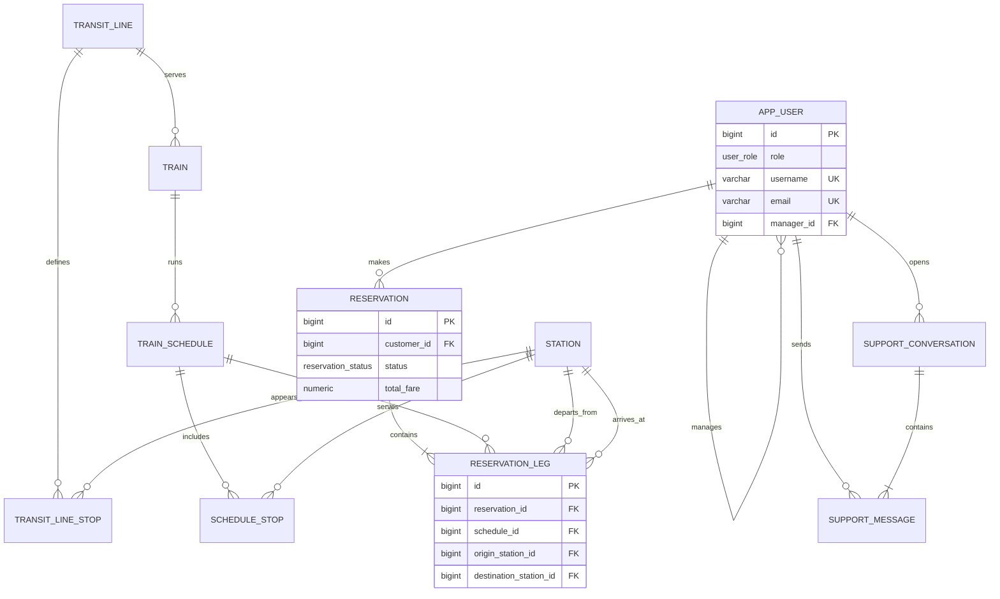

# Phase 0: PostgreSQL Data Model

## Purpose

This document is the agreed starting point for the Spring Boot rewrite. It
uses the legacy ERD and the servlet/JSP behavior as references, but it does
not reproduce their schema defects. Flyway migrations in
`backend/src/main/resources/db/migration` are the executable source of truth.

## Design Decisions

- PostgreSQL is the local development database. It will run in Docker during
  Phase 1.
- `app_user` replaces the three legacy credential tables (`Customer`,
  `CustomerRep`, and `Manager`). A role captures the current mutually
  exclusive account type, and representative-to-manager reporting is a
  self-reference.
- Passwords are stored only as BCrypt hashes. The development seed password
  exists solely for local use and is documented in the seed migration.
- Monetary values use `numeric(10,2)`, never floating point.
- A reservation has one or more `reservation_leg` rows. This makes a round
  trip representable without attaching a single schedule to an entire
  round-trip booking.
- Support uses conversations and individual messages rather than an
  incomplete `Message.reply_text` column. A legacy question/reply maps to one
  conversation containing two messages.
- A route has template stops (`transit_line_stop`), while each schedule has
  timestamped stops (`schedule_stop`). This replaces the legacy global
  `Stop.stop_order` key and makes the View Stops feature implementable.
- The legacy `handles_reservation` table is intentionally excluded. No
  committed servlet or JSP reads or writes it, and its real workflow has not
  been defined.

## Domain Diagram

## Legacy-to-New Mapping

| Legacy design | New model | Reason |
| --- | --- | --- |
| `Customer`, `CustomerRep`, `Manager` | `app_user` with `role` | Removes duplicated credential columns and plaintext password storage. |
| `CustomerRep.manager_ssn` | `app_user.manager_id` | Keeps representative reporting without SSNs as primary keys. |
| `Reservation` with one `schedule_id` and `reservation_type` | `reservation` plus `reservation_leg` | Supports one-way and return itineraries consistently. |
| `Message` with missing `reply_text` | `support_conversation` and `support_message` | Preserves full message history and clear sender identity. |
| `Stop` keyed only by `stop_order` | `transit_line_stop` and `schedule_stop` | Stop sequences are scoped to routes/schedules. |
| `handles_reservation` | Deferred | It is unused by the committed application. |

## Rules Carried Into the Rewrite

- Customers own reservations and can only cancel their own active bookings.
- Representatives are assigned to one manager and can manage schedules and
  respond to support requests.
- Admins manage representatives and view aggregate reports.
- Fares are calculated server-side from the selected schedule, passenger type,
  and booking legs; the client never submits a trusted fare.
- Reports derive from active reservations and reservation-leg fares.

## Phase 0 Limits

The schema establishes the backend contract; it does not yet include a Spring
Boot application, Docker Compose file, REST endpoints, or frontend. Those
arrive in Phases 1 through 5.
